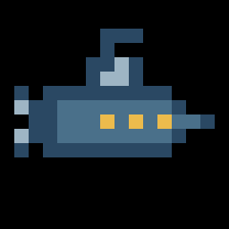

# Yoto Icon Maker

An unofficial toolkit for deliberately authoring and validating 16×16 track icons for Yoto Player and Yoto Mini.

Image generators are useful for exploring a silhouette. They are not reliable final renderers at 16×16. This workflow treats generated art as reference, rebuilds the sprite on the actual grid, previews it on black, and validates the upload file deterministically.

> Unofficial community project. Not affiliated with or endorsed by Yoto.



The repository includes both the true [`16×16 upload file`](examples/submarine.png) and this nearest-neighbor preview.

## What it checks

- PNG format
- exact 16×16 dimensions
- RGBA mode and real transparency
- no visible pure-black pixels
- compact opaque palette
- edge-touch warnings
- nearest-neighbor preview on black

## Quick start

```bash
python3 -m venv .venv
.venv/bin/pip install -e .

.venv/bin/yoto-icon verify examples/submarine.png --preview /tmp/submarine-preview.png
```

Or without installation:

```bash
PYTHONPATH=src python3 -m yoto_icon_maker.cli verify examples/submarine.png \
  --preview /tmp/submarine-preview.png
```

## Workflow

1. Choose one unmistakable silhouette.
2. Generate reference art if useful.
3. Rebuild it on an exact 16×16 RGBA canvas.
4. Use roughly four to eight opaque colors.
5. Avoid visible pure black; the display background is black.
6. Validate and inspect the enlarged black-background preview.
7. Upload manually through Yoto's Make Your Own interface.

## Test

```bash
.venv/bin/python -m unittest discover -s tests -v
```

## Agent use

`SKILL.md` contains a portable workflow for Hermes and other skill-aware agent harnesses. The Python validator is independent of Hermes.

## License

MIT. “Yoto” is a trademark of its respective owner.
